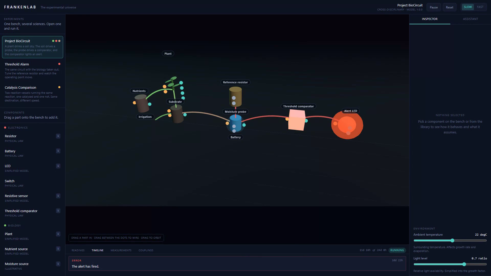
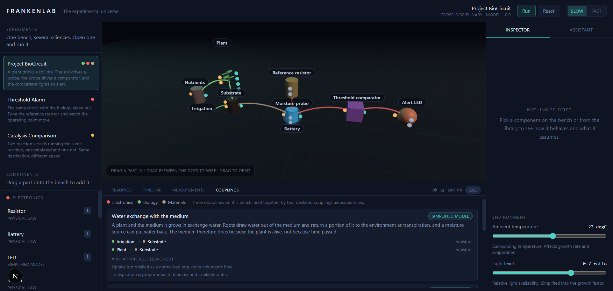
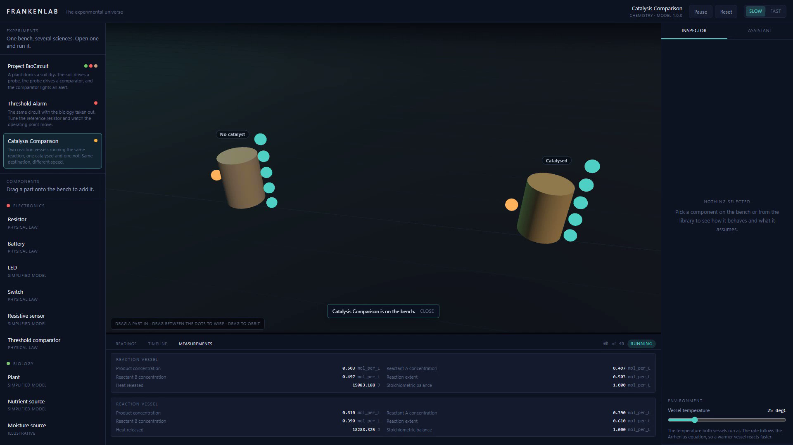
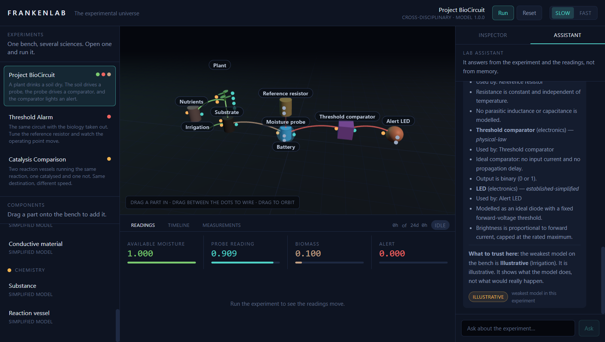
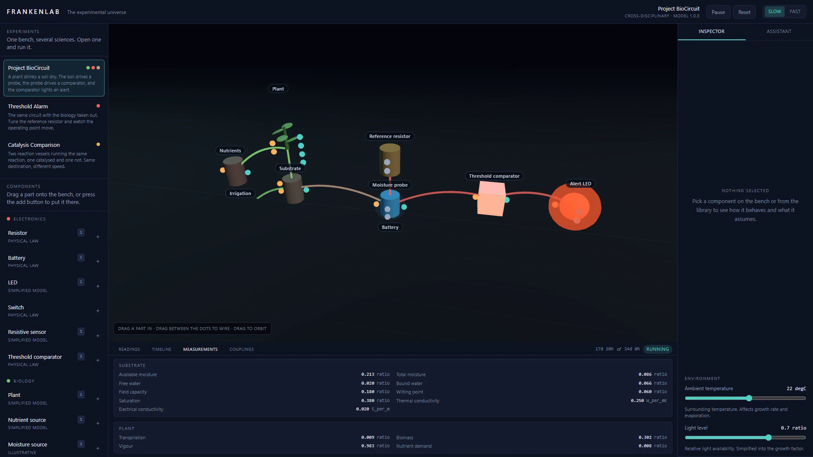
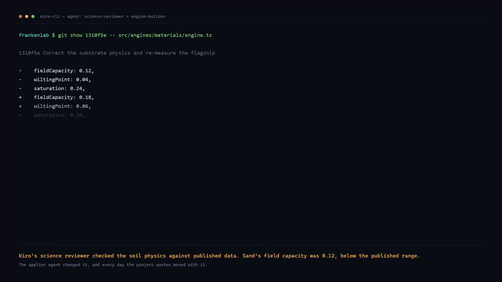

# FrankenLab

**The experimental universe.** An interactive scientific sandbox where
electronics, biology, materials and chemistry share one component graph and
one simulation kernel.

Build it. Break it. Discover it.



**Try it now:** [frankenlab.vercel.app](https://frankenlab.vercel.app) — no install,
no API key, nothing to sign up for. It works on a phone: the bench and its
readings stay on the screen, and the catalogue, the inspector and the assistant
slide up from the bottom when you want them.

**Watch it work:** [the 2:22 demo](docs/demo/frankenlab-demo.mp4)
— the run, the recovery, the catalyst, the assistant, the named rules that
carry the experiment, and the Kiro moment that moved the whole story three
days.

---

## What this is

Most science simulators teach one subject. FrankenLab's premise is different:
the interesting experiments live in the gaps between subjects.

So FrankenLab has a **shared simulation kernel** that knows nothing about any
science. A discipline is a plugin that supplies component definitions and a
step function. Adding a fifth discipline — chemistry — touched no kernel
code at all.

That is what makes the Frankenstein claim structurally true rather than
aspirational. An electrical netlist and a logistic growth curve genuinely do
share one representation, because the representation is the thing that knows
neither of them.

The flagship experiment, **Project BioCircuit**, is the proof:

```
  plant  ──transpires──▶  medium  ──moisture──▶  resistive probe
                                                        │
                                              divider tap voltage
                                                        ▼
                                    comparator  ──▶  alert LED
```

A plant drinks a medium dry. The medium's moisture drives a resistive probe.
The probe sits above the tap of a voltage divider, so as the medium dries the
probe's resistance rises and the tap voltage falls. When the tap crosses the
comparator's threshold, the LED lights.

The comparator thresholds a **solved circuit quantity**, not the moisture that
drove it. Change the reference resistor and the day the alarm goes off
changes with it. The electronics is load-bearing, not decoration.

The medium decides the pace of the whole experiment. Swapping sand for clay
holds the alarm off for a week, and hydrogel holds its water past the end of
the run:

| Medium   | Alert fires        |
| -------- | ------------------ |
| Sand     | day 11             |
| Loam     | day 13             |
| Clay     | day 17             |
| Hydrogel | not within 24 days |

### The rules that carry it

A circuit cannot know about a plant, and a plant cannot know about a circuit.
What they share is a named rule, declared in
`src/interactions/couplings.ts`, that says which quantity crosses the
boundary and how much the crossing is worth.

The **Couplings** tab lists the rules carrying the experiment on the bench
right now: which part sends what to which part, on which channel, and what the
rule leaves out. It is derived from the live graph, so cutting a wire removes
the rule that wire was carrying. Open the Threshold Alarm and it says nothing
crosses over, because in that experiment nothing does.



## Three experiments, not one

The bench opens with a catalogue, because a sandbox with a single experiment
in it is a demonstration.

| Experiment | What it shows |
| ---------- | ------------- |
| **Project BioCircuit** | The flagship. Soil, a plant, a probe and an alarm. |
| **Threshold Alarm** | The same circuit with the biology taken out. Turn the reference resistor from 40 kOhm to 10 kOhm and the alarm goes out. |
| **Catalysis Comparison** | Two vessels, the same reaction, one catalysed and one not. Same destination, nine times sooner. |

The catalysis comparison is the sharpest of the three. The equilibrium is not
guessed at from a rate that looks small: the mass-action law gives a quadratic
in the extent of reaction, and the smaller root is where the reaction is
heading. Measured by `scripts/measure-catalysis.ts`:

| | Uncatalysed | Catalysed |
| --- | --- | --- |
| Solved equilibrium | 0.609612 mol/L | 0.609612 mol/L |
| Within 1 per cent of it | minute 110 | minute 12 |
| Product after four hours | 0.609569 mol/L | 0.609612 mol/L |

The two vessels finish 0.000043 mol/L apart. The catalyst changed the speed
and not the destination, and the numbers say so.



## Build it yourself

Parts are dragged from the catalogue onto the bench and wired by dragging
between the dots on them. The bench and the simulator share one validator, so
a wire refused on the bench is refused for exactly the same reason. A refused
wire explains itself in plain English: *"Trigger" is an input on LED, so
nothing comes out of it.*

## Principles

**The simulation computes. The AI interprets. The user decides.**

The AI assistant is never the source of a number. It reads the same
structured context the UI reads, and it cites the values it uses. With no
provider configured it still works, because a deterministic local explainer
answers from the same context.

**Every answer says what it is worth.**

An experiment is only as trustworthy as its weakest model, so the assistant
names that model and says what its confidence level means:

> **What to trust here:** the weakest model on the bench is **Illustrative**
> (Irrigation). It is illustrative. It shows what the model does, not what
> would really happen.

And the guard runs on every reply, whoever wrote it. A number the simulation
did not produce is removed from the answer, and the removal is stated. A whole
number at or below 1 is left alone, because "day 1" and "one step" are far more
often writing than a measurement. A decimal is checked however small it is.



**Scientific honesty is a product feature.** Every component carries a
confidence level and states its own assumptions in plain English:

| Level                  | Meaning                                                        |
| ---------------------- | -------------------------------------------------------------- |
| `physical-law`         | Conserved and independently verifiable.                         |
| `established-simplified` | An established model reduced for teaching.                     |
| `illustrative`         | Qualitative. Useful for feel, not for numbers you would publish. |
| `hypothetical`         | Speculative by design.                                          |

**Reproducible means reproducible.** Fixed timestep, seeded randomness, stable
ordering. Same experiment plus same seed gives an identical result, and there
is a property-based test that proves it.

## Running it

The simplest way to run it is in a browser, with nothing to install:

**[frankenlab.vercel.app](https://frankenlab.vercel.app)**

To run it yourself:

```bash
npm install
npm run dev          # http://localhost:4310
```

Then open the laboratory, press **Run**, and watch the plant drink the medium
dry while the readout falls and the alarm lights. The run takes about a
minute at the default speed, which is slow enough to follow: the alert goes
off on day 11, growth stalls on day 20 and the medium wilts on day 21.
**Fast** gets to the end state in about six seconds.

And it can be saved. Pause the run, turn the irrigation up in the inspector,
and carry on: the medium comes back above its wilting point, the timeline
records the recovery, and the LED goes out. The simulation computes, the
timeline shows what happened, and you decide what to do about it.

Under the bench there are four tabs. **Readings** shows the headline numbers
for whichever experiment is open and their history. **Timeline** lists every
moment the simulation reported, in order, with a severity and a plain-English
explanation. **Measurements** lists every quantity the kernel produced,
grouped by the part it came from, with its unit. **Couplings** lists the named
rules carrying the experiment across its disciplines.



Other commands:

```bash
npm run typecheck    # tsc --noEmit
npm run lint         # eslint
npm test             # vitest run
npm run test:pbt     # property-based tests only
npm run verify       # all three
npm run build        # production build
npm run build:static # static export into out/
npm run measure      # re-measure every day this project quotes
npm run measure:nutrients # the nutrient reservoir's balance
```

Requires Node 20.9 or newer. No API key. No database. No network calls.

Source: [github.com/wescosmic/frankenlab](https://github.com/wescosmic/frankenlab),
MIT licensed.

See [docs/SETUP.md](docs/SETUP.md) for the full setup and troubleshooting, and
[CONTRIBUTING.md](CONTRIBUTING.md) if you intend to change the code. The
[docs/KIRO-WRITEUP.md](docs/KIRO-WRITEUP.md) covers the eight Kiro surfaces the
competition asks about.

## Building it with Kiro

This project is developed with the **Kiro CLI**. The CLI is not a reduced IDE:
it is the same agent harness with the same `.kiro/` configuration, plus headless
mode and ACP. It is also the surface the competition asks you to compare, so
the differences are worth observing rather than assuming.

```bash
kiro-cli chat --v3
```

Trust the workspace when prompted, or none of the steering, agents, hooks and
skills in `.kiro/` will load.

| What                | Where                                                     |
| ------------------- | --------------------------------------------------------- |
| Specs               | `.kiro/specs/frankenlab/` — requirements, design, tasks     |
| Steering            | `.kiro/steering/` — product, architecture, standards, integrity |
| Specialist agents   | `.kiro/agents/` — kernel guardian, engine builder, science reviewer, UI integrator, and the lead that delegates to them |
| Hooks               | `.kiro/hooks/` — session context, lint on save, destructive-shell guard, verify on stop |

```bash
/spec view frankenlab tasks      # read the spec
/agent swap lab-lead             # switch to the orchestrator
/agent swap kernel-guardian      # or work with a specialist
```

**Kiro drives MiniMax.** MiniMax M2.5 is in Kiro's own model catalogue at
0.25x credit cost. Pick it with `/model`. You cannot supply your own MiniMax
API key to Kiro: there is no custom provider or base URL setting. If you want
another agent driving Kiro, that is ACP or the headless JSON-lines mode, not a
provider setting.

Full procedure, including the scripted one-shot pass and the ACP wiring, in
[docs/CLI-WORKFLOW.md](docs/CLI-WORKFLOW.md).

### The moment it changed the product

The substrate model claims `established-simplified` confidence, which means it
may be simpler than reality but not wrong. A `science-reviewer` agent checked
the four substrate presets against two published sources, found sand's field
capacity below the published range, and a `engine-builder` agent applied the
correction and re-measured every day the project quotes.

The visible outcome is in the product. The alert used to fire on day 8 and
the medium used to wilt on day 16. Now the alert fires on day 11 and the
medium wilts on day 21, and the recovery follows. Those days are in the
Timeline tab, in this README, in the spec and in the code, and they agree
because a measurement script measures them rather than restating them.



## Architecture

```
React + Three.js  ──▶  workbench store  ──▶  KERNEL  ──▶  discipline engines
   (UI layer)          (application)       (domain-      (electronics,
                                           agnostic)      biology,
                                                            materials,
                                                            chemistry)
```

The rule that makes it work: **dependencies point downward only.** The kernel
never imports an engine. Engines never import each other. Cross-discipline
behaviour is expressed as named rules in `src/interactions/couplings.ts`,
never as an import.

| Folder                | What lives there                                            |
| --------------------- | ------------------------------------------------------------ |
| `src/app/`            | The Next.js entry point. Everything runs in the browser.     |
| `src/kernel/`         | The domain-agnostic core: units, types, registry, validation, lifecycle. |
| `src/engines/`        | One folder per discipline. Plugins.                           |
| `src/interactions/`   | The interdisciplinary coupling rules.                         |
| `src/scenarios/`      | Ready-made experiments.                                       |
| `src/assistant/`      | The AI lab assistant and its tools.                           |
| `src/three/`          | The Three.js laboratory scene.                                |
| `src/components/`     | The React panels.                                             |
| `src/state/`          | The workbench store.                                          |
| `src/confidence.ts`   | The four confidence levels, what they mean and how they look. |
| `src/drag.ts`         | The drag-and-drop contract between the catalogue and the bench. |
| `src/world.ts`        | The one place that builds the registry.                       |
| `tests/`              | Unit, integration and property tests.                         |

Full detail in [docs/ARCHITECTURE.md](docs/ARCHITECTURE.md) and
`.kiro/specs/frankenlab/design.md`.

## Adding a discipline

A new discipline is one folder and one line.

```ts
// src/engines/myfield/engine.ts
export const myFieldEngine: DisciplineEngine = {
  id: 'myfield',
  name: 'My field',
  version: '1.0.0',
  components: [myComponentDefinition],
  behaviors: new Map([['myfield.thing', myComponentBehavior]]),
  connectionRules: myRules,
};
```

```ts
// src/world.ts
registry.registerEngine(myFieldEngine);
```

That is the whole integration. The kernel does not change, and the component
appears in the catalogue, the validator and the workbench.

## Tests

```bash
npm test
```

182 tests across fifteen files. The interesting ones are the property-based
invariants in `tests/properties/`:

- The source delivers exactly the power the resistors dissipate.
- A divider output always lies between the rails.
- The medium never gains water when nothing is added to it.
- No normalised reading leaves 0–1.
- The same seed gives the same result, every time.

And the contracts that keep the product honest:

- **`tests/ports.test.ts`** wires every component in the world into one graph
  and checks that every output port publishes its value under its own port id.
  A value published under any other name is a value no wire can carry, and it
  fails silently. This test found three real bugs, including an unwired part
  on the bench collapsing the whole circuit solve.
- **`tests/trust.test.ts`** checks that the assistant cannot cite a number the
  simulation did not produce, and that every answer states what it is worth.
- **`tests/couplings.test.ts`** checks that the couplings panel names the same
  rule the kernel itself applies to each wire, and that nothing is shown that
  is not declared in the coupling file. A panel that invents a rule is as bad
  as an assistant that invents a measurement.
- **`tests/architecture.test.ts`** reads the import graph and checks the one
  claim the whole design rests on: the kernel has never heard of any
  discipline, no engine imports another engine, and every cross-discipline
  rule lives in one reviewable file.
- **`tests/design-tokens.test.ts`** checks that every colour the interface asks
  for is actually declared. A Tailwind utility for a colour that was never
  defined does not fail, it does not exist, and the element falls back to
  whatever it inherited. It also checks that every text colour clears WCAG AA
  against the panel it sits on.
- **`tests/observations.test.ts`** asserts the days the flagship reaches, the
  ones the README, the spec and the demonstration all quote. A test that
  asserts a shape is worth less than a test that asserts a day.
- **`tests/interactions.test.ts`** checks that the nutrient reservoir is a real
  coupling: that the plant's demand is a rate, so that over one step the
  reservoir gives back its regeneration and loses the demand multiplied by the
  step. The plant used to compute a demand and throw it away, and nothing
  caught it until this test did.

## Honest limitations

- The chemistry model is deliberately small: one reversible reaction in one
  closed vessel.
- The biology is a teaching model, not a crop simulator.
- The electronics solver is DC resistive nodal analysis. There is no
  capacitance, no inductance and no transient behaviour.
- The assistant uses a deterministic local explainer. A live model provider
  is not wired up, though the trust guard is already in front of it.
- Runs are not persisted and cannot be compared side by side yet.
- Most of this was built with Kiro agents, but two phases were built by hand
  because the Kiro account's monthly quota ran out. The full account is in
  [docs/KIRO-WRITEUP.md](docs/KIRO-WRITEUP.md).
- FrankenLab is a learning environment. It does not replace a laboratory.

## Licence

MIT. See [LICENSE](LICENSE).
